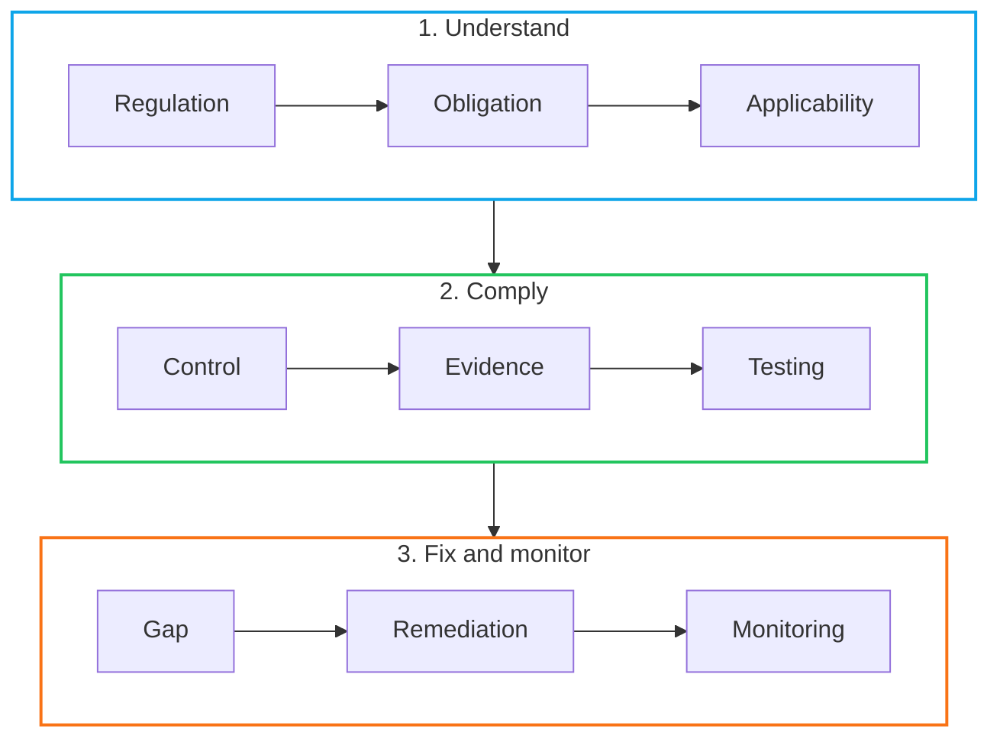
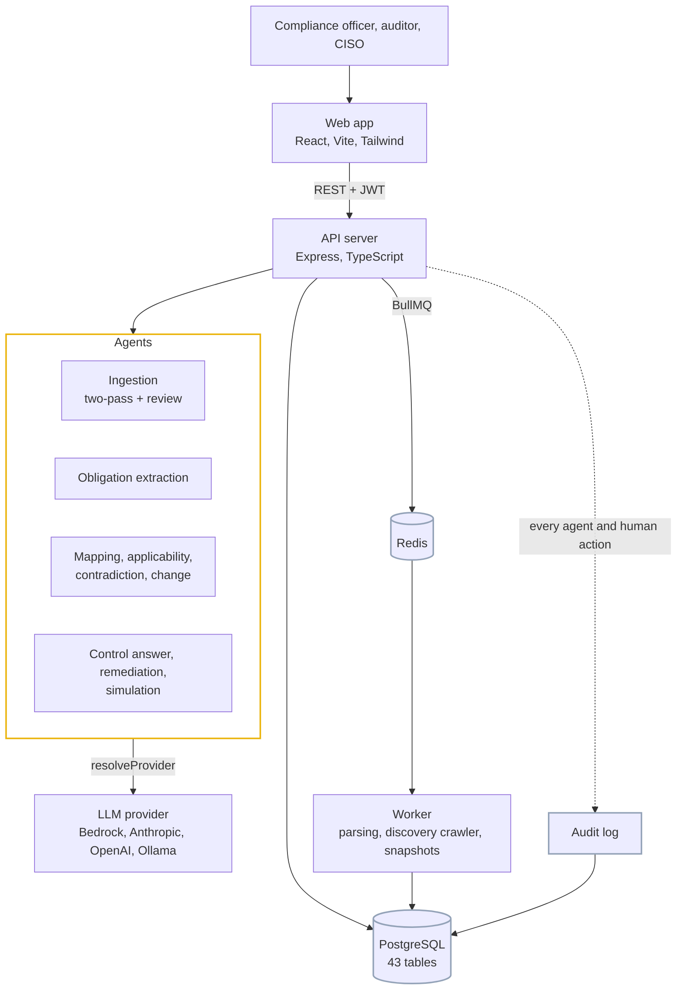

# ComplianceOS

### An agentic pipeline that traces banking regulation from the circular to the fix, and keeps it traced.


---

## Demo

[](https://youtu.be/izO__Emx9x0)

Watch the demo on [YouTube](https://youtu.be/izO__Emx9x0).

## The problem

Banks work under regulations that differ by geography, product and structure, and the rules keep changing. Compliance teams keep answering the same question: *"for this rule, what do we do about it, where is the proof, and what is still open?"* The answer usually lives in spreadsheets and people's heads, and it goes stale the day a circular changes.

ComplianceOS keeps one traceable chain from the regulator's sentence to the remediation ticket, and updates it as regulation changes:



A regulatory change in step 3 loops back to step 1.

Each hop is a real relationship in the database (`Circular → Obligation → ObligationControl → Control → Evidence / ControlTest / MonitoringKpi → ComplianceGap → RemediationPlan`). The Traceability matrix shows them together, so you can walk any gap back to the exact clause it came from.

---

## What makes it different

| | |
|---|---|
| Two independent readings | Every scanned page is read twice. If the readers disagree, or a quote can't be found in the page, the item is flagged for review and stays out of the promotion step until a reviewer accepts, corrects or rejects it (through the API). Obligations created from a scan keep their source page and region, and the obligation page shows that region on the page image. |
| Verbatim citations | The extraction agent has to return a word-for-word `sourceQuote` for every obligation. The server checks that quote against the circular text and stores `citationVerified`. Unverified citations are flagged for a human. |
| Scheduled agents | A control-answering agent drafts answers from mapped obligations, evidence and the knowledge base every *N* hours, and discovery runs can be scheduled to look for new circulars. Schedules, runs, stages and results are recorded. |
| Human review | Extracted obligations are proposals until a reviewer confirms or dismisses them. Risk acceptance, sign-off and remediation approval are explicit human actions, each with an audit trail. |
| Tamper-evident sign-off | When an officer signs off an obligation→control chain, the signature stores a SHA-256 of the chain. If anything in it changes later, the page shows "Changed since sign-off" instead of a green tick. |
| What-if simulation | Simulate an amendment, such as a tighter breach-reporting window, and see which controls fall out of compliance, the new gaps, and the cost and days to fix. |
| Cross-regulation conflicts | Conflicting clauses across RBI, SEBI and CERT-In are stored as records, with the strictest common rule and a per-obligation *harmonized* flag. |
| Choice of model provider | AWS Bedrock (default: Amazon Nova Pro), Anthropic, OpenAI or a local Ollama model, set per organization with encrypted keys. |

---

## Feature coverage

| # | Feature | Where it lives | Status |
|---|---|---|---|
| 1 | Regulatory intelligence & knowledge ingestion | Regulations library, multimodal ingestion API (scans, tables, diagrams, xlsx/docx, screenshots) | ✅ |
| 2 | Regulatory change intelligence | RBI/SEBI RSS crawler, `PENDING_REVIEW` circulars, old-vs-new diff with impacted controls and gaps that may reopen | ✅ |
| 3 | Obligation extraction | `obligationExtractionAgent`: chunked, schema-validated, quote-verified | ✅ |
| 4 | Bank control-framework understanding | Controls, control questions, framework libraries, document library | ✅ |
| 5 | Regulatory-to-control mapping | Auto-mapping agent + applicability agent, suggestions with confidence and rationale, human review | ✅ |
| 6 | Control effectiveness assessment | Control tests, test runs, monitoring KPIs, implementation status | ✅ |
| 7 | Evidence-based compliance assessment | Evidence per control, autonomous answering grounded in evidence | ✅ |
| 8 | Gap identification | Gaps from controls / questions, "Mark as Gap", status sync | ✅ |
| 9 | Risk-based gap prioritization | Risk tiers, aging, dashboard, export-blocker logic | ✅ |
| 10 | Remediation recommendation engine | `remediationAgent` → persisted plan + owner/due-dated actions | ✅ |
| 11 | Autonomous regulatory impact analysis | Impact breakdown per scenario (controls, gaps, cost, days), model-reasoned per control | ✅ |
| 12 | What-if / simulation | Scenario builder; AI graph reasoning or heuristic; per-control reasons | ✅ |
| 13 | Cross-regulation intelligence | Cross-regulator contradiction view and harmonization | ✅ |
| 14 | Regulatory contradiction detection | AI-detected conflicts with both quotes verified, human confirm/reject, harmonization | ✅ |

The input is heterogeneous: scanned circulars, images, tables, flowcharts, Excel and Word files, and evidence screenshots. Reliability comes from two independent readings of every page that must agree, quote grounding, a review step before anything is promoted, per-document reliability metrics, hash-verified sign-off, an append-only audit log and tenant isolation. The evidence for each claim is in [`docs/architecture.md`](docs/architecture.md).

---

## Architecture at a glance



The `@complianceos/shared` package holds the enums, zod request schemas and response types that the server, worker and web all use, so the database, API and UI can't drift apart without a compile error.

Every org-scoped row carries `organizationId`. Shared library content is read-only for tenants, and runs, gaps and audit trails belong to the organization that produced them.

---

## Try it

### Zero-setup demo (no backend)

```bash
npm install
npm run dev --workspace=web        # http://localhost:5173
```

Click **Quick Demo** on the login page. You are signed in as a demo compliance officer on a curated RBI/SEBI dataset that follows one story from circular to obligations, controls, gaps and remediation. A suggested path:

1. **Regulations** → filter *AI Indexed: Indexed*, open *IT Framework for the NBFC Sector*.
2. **Obligations** → open the circular, *Re-run Extraction*, see verified vs unverified citations.
3. **Obligation detail** → open the first obligation: it shows the page of the scanned circular it came from, with the source region highlighted.
4. **Controls** → *Autonomous Answering Agent* panel → *Run now*; open a control, *Mark as Gap*.
5. **Gaps & Remediation** → open the gap, *Generate Plan*.
6. **Traceability** → follow one chain end to end, *Sign off*.
7. **Simulation** → run a scenario, read the blast radius.
8. **Audit Log** → every step above is recorded here.

### Full stack

Requirements: Node 22.13+ (CI runs 24) and Docker (or your own PostgreSQL 15+ and Redis).

```bash
cp .env.example .env               # set JWT_SECRET, ENCRYPTION_KEY, AWS_BEARER_TOKEN_BEDROCK …
docker compose up -d               # Postgres 16 + Redis 7; the schema is applied on first start
npm install
npm run dev                        # shared (watch) + server :4000 + worker + web :5173
```

`.env.example` already points at the Docker services. To start over with an empty database, run `docker compose down -v` and then `docker compose up -d`. If you use your own Postgres instead, apply the schema with `npm run migrate` (add `-- reset` to drop first).

AI defaults come from the environment (AWS Bedrock by default):

```
AWS_BEARER_TOKEN_BEDROCK=…         # or AWS_ACCESS_KEY_ID / AWS_SECRET_ACCESS_KEY / an instance role
AWS_REGION=ap-south-1
AWS_BEDROCK_MODEL_ID=apac.amazon.nova-pro-v1:0
```

Organizations can switch provider or bring their own key under **Settings → AI**.

---

## Repository layout

| Path | What's inside |
|---|---|
| [`web/`](web) | React + Vite frontend: pipeline pages, traceability, simulation, audit log, settings |
| [`server/`](server) | Express API, AI agents (`src/ai`), services, scheduler, auth (JWT, OTP, Google) |
| [`worker/`](worker) | BullMQ worker: document parsing, discovery runs, daily snapshots |
| [`shared/`](shared) | Enums, zod schemas and response types shared by all packages |
| [`sql/postgres/`](sql/postgres) | `full_schema.sql`, `full_delete_schema.sql`, seed helpers |
| [`docs/architecture.md`](docs/architecture.md) | Detailed structural architecture and claim-by-claim evidence |

## Quality gates

GitHub Actions (`.github/workflows/ci.yml`) runs these on every push to `main` and every pull request:

| Job | Checks |
|---|---|
| Build and lint | `npm ci`, full build of shared, server, worker and web, lint across all packages |
| Dependency security | `npm audit` (fails on any known vulnerability) |
| Database schema | applies `full_schema.sql` to Postgres 16, drops it with `full_delete_schema.sql`, re-applies, and confirms nothing is left behind |
| API boots against the schema | starts the built server on a migrated database, checks `/health` and that unauthenticated requests get 401 |

Run the same checks locally:

```bash
npm run lint      # eslint across server, worker, web
npm run build     # tsc -b for shared/server/worker + vite build
npm audit         # 0 known vulnerabilities
```

During development, the schema (`full_schema.sql`, 43 tables) was applied, dropped and re-applied cleanly, and the API was exercised end to end against a Postgres engine.

---

## Honest boundaries

What we have not proven:

* Accuracy has not been benchmarked against a labelled set of real scans. Reliability comes from dual-pass agreement, quote grounding and human review, reported per document.
* The second reader defaults to the same Bedrock model with a blind prompt. Set `AWS_BEDROCK_VERIFIER_MODEL_ID` to use a different model.
* End-to-end tests used a deterministic mock model (`AI_MOCK=1`) and canned RSS feeds. Behaviour with a real model and live feeds depends on your credentials and network, and `.docx` ingestion has no test fixture yet.
* Demo mode uses curated synthetic data, including a synthetic scanned page. It never calls a model.
* Multimodal ingestion is an API (`/ingestion`) with no review screen in the web app; reviewing and promoting items is done through the API.
* Existing databases need `npm run migrate -- reset` to pick up the new tables.

---

## License

Copyright (c) 2026 RightToAudit.ai Software Private Limited.

ComplianceOS is source-available under the [Business Source License 1.1](LICENSE). You can read, copy, modify and run it for non-production use, and use it in production for your own internal business purposes. You may not use it to offer a hosted or competing service to third parties. On 2030-10-11, or the fourth anniversary of a version's first public release if earlier, each version converts to the GNU Affero General Public License v3.0, so anyone who then hosts a modified copy must share their changes.

For a commercial license, contact [contact@righttoaudit.ai](mailto:contact@righttoaudit.ai).
