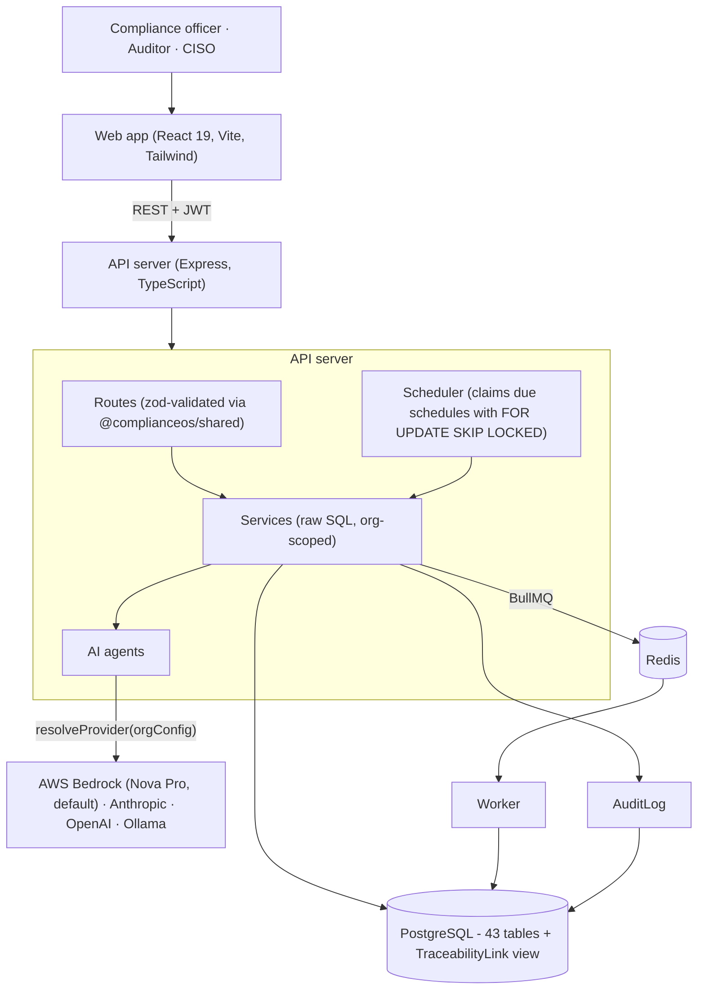

# ComplianceOS - Structural Architecture & Claim Evidence

This document is the detailed architecture that accompanies the working product. It maps every claim in the demo to a concrete mechanism in the code, and states plainly where a capability is real, partial, or out of scope.

---

## 1. Features, input handling and reliability

**Features.** ComplianceOS implements 14 features across the regulation-to-remediation chain (see section 4). Each is backed by a model-driven agent with a deterministic fallback and a human review gate.

**Input handling.** Input is heterogeneous and multimodal: scanned and text PDFs, images and screenshots, tables, flowcharts and diagrams, Excel and Word files, alongside plain text and structured records. The mechanisms that make the output reliable are:

| Reliability mechanism | Where |
|---|---|
| Verbatim-citation invariant: every extracted obligation must quote the source; the server re-verifies the quote against the circular and stores `citationVerified` | `server/src/ai/agents/obligationExtractionAgent.ts` |
| Schema-validated model output (zod) with rejection of malformed JSON | `shared/src/schemas/obligation.ts`, `remediation.ts` |
| Confidence score per obligation and per obligation→control mapping | `Obligation.confidence`, `ObligationControl.confidence` |
| Human review gates: confirm/dismiss obligations, approve remediation plans, sign off chains | `Obligation.status`, `RemediationPlan.status`, `TraceabilitySignoff` |
| Tamper-evident sign-off: SHA-256 of the chain at sign-off; verified on read | `server/src/services/traceabilityService.ts` (`computeChainHash`) |
| Append-only audit log of every human and agent action (actor type USER / AI / SYSTEM) | `AuditLog`, `server/src/services/audit.ts` |
| **Two independent readings of every page** (pass A on the org's model, pass B blind on a verifier model with a differently worded prompt); item agreement computed by text similarity; disagreement is never auto-accepted | `server/src/ai/agents/ingestionAgent.ts`, `services/ingestion/` |
| **Grounded quotes on scanned input**: clause quotes are checked against the PDF text layer or the other pass's transcription; `quoteVerified` stored per item | `ExtractedItem.quoteVerified` |
| **Review step with page-region provenance**: AGREED / NEEDS_REVIEW / DISPUTED items, side-by-side pass A vs pass B, accept / correct / reject before anything is promoted | `PATCH /ingestion/items/:id`, `POST /ingestion/files/:id/promote` (API only; the web app shows the source region on the obligation page) |
| **Per-document reliability metrics**: agreement rate, quote-match rate, mean confidence, items needing review | `IngestedFile.metrics` |
| Provenance carried into the pipeline: obligations keep `sourceFileId`, `sourcePage`, `sourceRegion` so a clause can be shown on the original page | `Obligation`, `Evidence.sourceFileId` |
| Every AI suggestion (mapping, applicability, contradiction, change) is stored as `SUGGESTED` with confidence and rationale, and only counts once a human confirms | `reviewStatus` columns |
| Tenant isolation on every org-scoped table | `organizationId` on all rows; global library rows are read-only to tenants |

Inputs handled: **scanned circulars and images** (rasterized with pdf.js, read by a multimodal model), **tables** to structured rows, **flowcharts/diagrams** to ordered steps, **Excel/Word** files (parsed deterministically), and **evidence screenshots** to structured facts. All of it flows through the same review queue. What we have not done: benchmark accuracy on a labelled corpus of real scans - the metrics are per-document and self-consistency based, not a measured ground-truth score.

---

## 2. The traceability chain

`Regulation → Obligation → Applicability → Control → Evidence → Testing → Gap → Remediation → Monitoring`

```mermaid
flowchart LR
    A["1 Regulation<br/><code>Circular</code>"] --> B["2 Obligation<br/><code>Obligation</code>"]
    B --> C["3 Applicability<br/><code>ObligationApplicability</code>"]
    C --> D["4 Control<br/><code>Control</code> + <code>ObligationControl</code>"]
    D --> E["5 Evidence<br/><code>Evidence</code> / <code>Document</code>"]
    E --> F["6 Testing<br/><code>ControlTest</code> / <code>ControlTestRun</code>"]
    F --> G["7 Gap<br/><code>ComplianceGap</code>"]
    G --> H["8 Remediation<br/><code>RemediationPlan</code> / <code>RemediationAction</code>"]
    H --> I["9 Monitoring<br/><code>MonitoringKpi</code> / <code>DailyPipelineSnapshot</code>"]
    I -. change feeds back .-> A
```

| Stage | Mechanism | Output | Human control |
|---|---|---|---|
| **1 Regulation** | Circular library (RBI + SEBI index), upload, discovery runs, AI-indexed flag (`Circular.indexedAt`) | Circular with regulator, category, version, supersession link | Adopt a discovered circular (`PENDING_REVIEW → ACTIVE`) |
| **2 Obligation** | Obligation Extraction Agent: chunk → LLM → zod validation → quote verification | Typed obligation (`REPORTING`, `GOVERNANCE`, `CONTROL`, `AUDIT`, …) with `sourceQuote`, `citationVerified`, `confidence` | Confirm / dismiss |
| **3 Applicability** | Per-obligation entities, criteria, status | `APPLICABLE` / `EXEMPT` / `CONDITIONAL` | Editable |
| **4 Control** | Controls (AI-suggested or manual) mapped many-to-many to obligations | `ObligationControl` with source and confidence | Add / remove mapping |
| **5 Evidence** | Evidence rows linked to controls and library documents; document lifecycle, expiry, classification | Evidence status `VERIFIED / PENDING / EXPIRED / MISSING` | Attach / review |
| **6 Testing** | Test definitions (`AUTOMATED_API`, `MANUAL_INSPECTION`, `EXTERNAL_AUDIT`, `VAPT`) and runs | Latest result `PASSED / FAILED / DEFICIENT` | Record run |
| **7 Gap** | Gaps from controls or questions; one open gap per control+obligation (unique index); control status kept in sync | Risk tier `LOW…CRITICAL`, status `OPEN / REMEDIATING / RISK_ACCEPTED / RESOLVED`, age | Accept risk, assign, resolve |
| **8 Remediation** | Remediation Agent → structured plan and owner/due-dated actions | Persisted `RemediationPlan` + `RemediationAction` | Approve plan |
| **9 Monitoring** | KPIs with health, daily pipeline snapshots, audit log | `HEALTHY / WARNING / BREACHED`, activity chart | - |

All nine hops are joined in one database view, **`TraceabilityLink`**, which powers the Traceability matrix and detail pages (`/traceability`). Sign-off hashes the chain; the detail page recomputes it and shows *Hash verified* or *Changed since sign-off*.

---

## 3. System architecture

### Components

| Package | Responsibility |
|---|---|
| `web` | Pipeline pages, traceability, simulation, audit log, settings. A **demo mode** runs the whole UI on one curated, connected dataset with no backend. |
| `server` | REST API, agents, services, scheduler, auth (password + OTP, Google code exchange), IP allowlist, AI provider resolution. |
| `worker` | BullMQ jobs: document parse status, discovery runs, daily pipeline snapshots. |
| `shared` | Enums, zod request schemas and response types - one contract for server, worker and web. |
| `sql/postgres` | Schema, teardown script, seed helpers. |

### Agents and automation (what actually exists)

| Agent | Trigger | Tools / inputs | Output & safeguards |
|---|---|---|---|
| **Obligation Extraction Agent** | On demand per circular | Chunked circular text → LLM → zod schema | Obligations with `sourceQuote`; server verifies quote is a substring of the circular (`citationVerified`); sets `Circular.indexedAt`; AI-actor audit event |
| **Control Answer Agent** | On demand per control/circular and **on a schedule** (1h to weekly, `AgentSchedule`) | Control, mapped obligations, evidence, approved knowledge-base entries | Draft answer that must not invent evidence (states what is missing); per-run record with stages, counts, errors (`ControlAnswerRun`); only the org's own controls are written |
| **Remediation Agent** | On demand per gap | Gap, linked obligation/control text | Structured plan (`planText`, `leadTeam`, `slaDays`, actions) validated with zod; saved as `PENDING_APPROVAL` |
| **Multimodal Ingestion Agent** | On upload (PDF, image, xlsx, docx) | Page images + text layer; pass A and independent pass B | Items (clause, table, diagram, figure, fact) with region, confidence, agreement and quote check; review queue; promotion to obligations / controls / evidence |
| **Discovery crawler** | Manual and scheduled | RBI and SEBI RSS feeds | New circulars as `PENDING_REVIEW`, deduped by link/reference; per-source counts and errors in run stages; a failing feed never aborts the run |
| **Change Analysis Agent** | On demand for an amended/superseding circular | Old vs new obligations (similarity match, then LLM classification) | `CircularChange`: added / removed / modified, impacted controls, gaps that may reopen; deterministic fallback |
| **Contradiction Agent** | On demand | Cross-circular obligation pairs shortlisted by shared topic | Proposals with both quotes verified against obligation text; unverified are flagged or dropped; stored `SUGGESTED` |
| **Mapping Agent** | On demand | Obligation + deterministic shortlist of candidate controls | `ObligationControl` suggestions (model may only choose shortlisted ids), coverage gaps reported |
| **Applicability Agent** | On demand | Obligation + organization profile | `ObligationApplicability` suggestions with rationale and confidence; human-confirmed rows never overwritten |
| **Simulation** | On demand | Obligation→control→evidence/test graph | `AI_GRAPH`: model decides which controls breach, with reasons; code computes every number. `HEURISTIC` fallback when no model. Method and per-control reasoning stored on the run |

**Provider abstraction.** `server/src/ai/resolveProvider.ts` returns the platform default (AWS Bedrock when credentials are configured, else Anthropic) unless the organization brings its own provider/key (`OrganizationAIConfig`, keys encrypted at rest). Bedrock uses the Converse API with `apac.amazon.nova-pro-v1:0` by default.

**Scheduling.** The scheduler ticks every minute; due `AgentSchedule` rows are claimed inside a transaction with `FOR UPDATE SKIP LOCKED` and advanced in the same transaction, so multiple server instances run each due schedule once. Runs left `RUNNING` by a crash are failed on startup.

---

## 4. Feature coverage

| # | Feature | Implementation | Demo path | Status |
|---|---|---|---|---|
| 1 | Regulatory intelligence & ingestion | Circular library (RBI + SEBI), upload, AI-indexed state | `/regulations` | ✅ |
| 2 | Regulatory change intelligence | RBI/SEBI RSS crawler, `PENDING_REVIEW` circulars, old-vs-new diff with impacted controls (`CircularChange`) | `/regulations`, circular detail | ✅ |
| 3 | Obligation extraction | `obligationExtractionAgent` with quote verification | `/obligations` | ✅ |
| 4 | Control-framework understanding | Controls, control questions, framework question sets, document library | `/controls`, `/library` | ✅ |
| 5 | Regulatory-to-control mapping | `ObligationControl` (N:M), mapping and applicability agents with confidence and rationale, human review | `/controls`, `/obligations` | ✅ |
| 6 | Control effectiveness assessment | Tests, runs, KPIs, implementation status | `/traceability` | ✅ |
| 7 | Evidence-based assessment | Evidence links; answer agent grounded in evidence | `/controls` | ✅ |
| 8 | Gap identification | Gaps from controls/questions, Mark-as-Gap, status sync | `/controls`, `/gaps` | ✅ |
| 9 | Risk-based prioritization | Risk tiers, aging, blockers, dashboard | `/gaps`, `/dashboard` | ✅ |
| 10 | Remediation recommendation | `remediationAgent` → persisted plan/actions | `/gaps` | ✅ |
| 11 | Autonomous impact analysis | Per-scenario blast radius; model decides which controls breach, code computes the numbers | `/simulation` | ✅ |
| 12 | What-if / simulation | Scenario builder, runs, breached controls | `/simulation` | ✅ |
| 13 | Cross-regulation intelligence | Cross-regulator contradiction view + harmonization | `/regulations/:id` | ✅ |
| 14 | Contradiction detection | AI-detected conflicts with both quotes verified, human confirm/reject, strictest common denominator | `/regulations/:id` | ✅ |

---

## 5. Data model

43 tables in `sql/postgres/full_schema.sql`, grouped by purpose:

* **Tenancy & auth**: `User`, `Organization`, `Membership`, `Invite`, `EmailOtp`, `OrganizationSettings`, `OrganizationIPWhitelist`, `OrganizationAIConfig`
* **Regulation → obligation → control**: `Circular`, `DiscoveryRun`, `Obligation`, `ObligationApplicability`, `Control`, `ObligationControl`, `Question`, `ControlQuestion`
* **Evidence, testing, monitoring**: `Document`, `DocumentVersion`, `Evidence`, `ControlTest`, `ControlTestRun`, `MonitoringKpi`, `KnowledgeBaseEntry`, `ControlKnowledgeEntry`
* **Gaps & remediation**: `ComplianceGap`, `RemediationPlan`, `RemediationAction`
* **Cross-regulation & what-if**: `RegulatoryContradiction`, `ContradictionParty`, `ObligationContradiction`, `SimulationScenario`, `SimulationRun`, `SimulationBreachedControl`
* **Multimodal ingestion**: `IngestedFile`, `IngestedPage`, `ExtractedItem`
* **Intelligence**: `OrganizationProfile`, `CircularChange`
* **Assurance & automation**: `TraceabilitySignoff`, `AuditLog`, `DailyPipelineSnapshot`, `AgentSchedule`, `ControlAnswerRun`
* **View**: `TraceabilityLink` (obligation → control chain with applicability, gap and remediation state)

Identifiers such as `OBL-00001` and `GAP-00001` come from database sequences, not counts, so they are safe under concurrency.

---

## 6. Responsible AI, security and oversight

1. **Anti-hallucination.** Obligations must cite verbatim; the server verifies the citation independently of the model and exposes the result. Remediation and extraction outputs are parsed against zod schemas; malformed output is rejected. The answer agent is instructed to state missing evidence rather than invent it.
2. **Human oversight.** AI output is a proposal: obligations need confirmation, remediation plans need approval, chains need sign-off, risk acceptance is explicit and recorded.
3. **Auditability.** Every agent and human action writes an `AuditLog` row (actor type, user, action, object, IP), exportable as CSV.
4. **Tamper evidence.** Sign-off stores a SHA-256 of the chain; verification recomputes it, so later changes are visible.
5. **Privacy & control of models.** Per-org provider choice including a fully local Ollama model; API keys are AES-encrypted at rest and never returned to clients.
6. **Access control.** JWT auth with roles (`ADMIN`, `EDITOR`, `VIEWER`), email OTP, optional org IP allowlist (guarded against self-lockout), tenant-scoped queries.

---

## 7. Demo walkthrough (about five minutes)

Start the web app and choose **Quick Demo** on the login page (`npm run dev --workspace=web`, then http://localhost:5173).

1. **Regulations**: filter *AI Indexed → Indexed*; open *Master Direction - IT Framework for the NBFC Sector*.
2. **Obligations**: open the circular and *Re-run Extraction*: obligations appear with quotes, section, confidence and *Citation verified / unverified* badges.
3. **Controls**: in the *Autonomous Answering Agent* panel choose a cadence and *Run now*; open a control and *Mark as Gap*.
4. **Gaps & Remediation**: open the gap, *Generate Plan*, review actions and owners.
5. **Traceability**: pick a chain, walk the nine steps, *Sign off*; see the verification badge.
6. **Simulation**: run a regulatory-amendment scenario; read blast radius, new gaps, cost and days.
7. **Audit Log**: every step above is recorded, filterable and exportable.

---

## 8. Scope and limitations (stated plainly)

* **Accuracy is not benchmarked.** Reliability is enforced by dual-pass agreement, quote grounding and human review; we have not measured accuracy against a labelled corpus of real scanned circulars.
* **Independence of the second reader.** Pass B defaults to the same Bedrock model with a blind, differently worded prompt; set `AWS_BEDROCK_VERIFIER_MODEL_ID` to use a genuinely different model.
* **Live paths tested with a mock model.** End-to-end tests ran against a deterministic mock provider (`AI_MOCK=1`); the RSS crawler was tested on canned feeds. Real-model and live-feed runs depend on your credentials and network.
* **Docx and diagram extraction** are the least tested inputs. `.docx` text extraction was checked once with a generated file, and no fixture is kept in the repo.
* **No review screen for ingestion.** Extracted items are reviewed and promoted through the API (`/ingestion`); the web app shows the source page and region on the obligation page only.
* **Demo mode**: curated synthetic data, including a synthetic scanned page; no model calls are made and demo uploads replay a curated result.
* **Existing databases** must be reset (`npm run migrate -- reset`) to pick up the new tables.
* **Scale**: single API process with a DB-backed scheduler; horizontally safe scheduling is in place, load testing is not.

## 9. Verification

* `npm run lint` - clean across server, worker and web.
* `npm run build` - `tsc -b` for shared, server, worker; `vite build` for web - clean.
* `npm audit` - 0 known vulnerabilities at the last clean run; one transitive finding (`source-map-js`) is waiting on a patched release that the registry's release-age policy has not yet allowed.
* Schema applies, drops and re-applies cleanly; the API surface was exercised end to end against a real Postgres engine during development.
